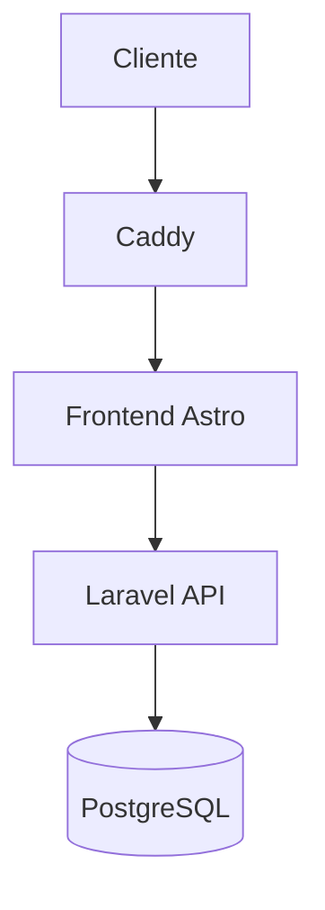

# Guía de estilo para documentación

Este documento define las reglas de formato, redacción y estructura para
la documentación del proyecto.

La guía aplica a documentación escrita por desarrolladores y por agentes
de IA. Su objetivo es mantener archivos `Markdown` claros, consistentes y
sin advertencias comunes de `markdownlint`.

---

## Alcance

Estas reglas aplican a:

```txt
docs/
README.md
AGENTS.md
```

También aplican a cualquier archivo nuevo de documentación que se agregue
al proyecto.

---

## Principios generales

La documentación debe ser:

- **Clara**: explicar cada tema sin rodeos.
- **Técnica**: usar nombres reales de archivos, carpetas y módulos.
- **Mantenible**: evitar duplicación innecesaria.
- **Precisa**: separar lo implementado de lo pendiente.
- **Consistente**: seguir el mismo formato en todos los archivos.

---

## Idioma

La documentación debe escribirse en español.

Los nombres técnicos deben mantenerse en inglés cuando correspondan al
código o a la estructura real del proyecto.

Ejemplos:

- `Store`
- `ProductStore`
- `StoreDomain`
- `Laravel`
- `Astro`
- `PostgreSQL`
- `PUBLIC_API_URL`
- `/api/auth/login`
- `docs/architecture/overview.md`

---

## Longitud máxima de línea

Cada línea debe mantenerse en un máximo recomendado de 80 caracteres.

Esto evita advertencias como:

```txt
MD013/line-length
```

Cuando una oración sea larga, debe dividirse manualmente.

Incorrecto:

```md
El sistema cuenta con una arquitectura que permite
administrar varias tiendas desde una sola plataforma
centralizada.
```

Correcto:

```md
El sistema administra varias tiendas desde una sola plataforma
centralizada.
```

---

## Párrafos

Los párrafos deben usar saltos de línea manuales cuando superen
80 caracteres.

Correcto:

```md
Panda y Kitsune son tiendas diferentes para el cliente, pero forman parte
de una misma operación administrativa.
```

No es necesario dejar una línea en blanco en medio de una misma idea.
Usa una línea en blanco solo para separar párrafos distintos.

---

## Listas

Los elementos de lista también deben respetar el límite recomendado de
80 caracteres.

Incorrecto:

```md
- El sistema utiliza `Caddy` como reverse proxy para enrutar
  múltiples dominios hacia el frontend, el admin y la API.
```

Correcto:

```md
- El sistema utiliza `Caddy` como reverse proxy para enrutar múltiples
  dominios hacia el frontend, el admin y la API.
```

Cuando una línea de lista continúa, debe alinearse con dos espacios de
indentación.

---

## Encabezados

Cada archivo debe tener un solo encabezado principal con `#`.

Correcto:

```md
# Arquitectura general
```

La jerarquía recomendada es:

```txt
# Título del documento
## Sección principal
### Subsección
#### Detalle específico
```

No se deben saltar niveles sin necesidad.

Incorrecto:

```md
# Título

#### Detalle
```

Correcto:

```md
# Título

## Sección

### Detalle
```

---

## Encabezados duplicados

Evita repetir encabezados con el mismo texto dentro del mismo archivo.

Esto evita advertencias como:

```txt
MD024/no-duplicate-heading
```

Incorrecto:

```md
## ADR-001: Una sola base de datos

### Contexto

### Decisión

## ADR-002: Un solo backend

### Contexto

### Decisión
```

Correcto:

```md
## ADR-001: Una sola base de datos

### ADR-001 - Contexto

### ADR-001 - Decisión

## ADR-002: Un solo backend

### ADR-002 - Contexto

### ADR-002 - Decisión
```

En documentos ADR, cada subtítulo debe incluir el identificador del ADR.

---

## Bloques de código

Todo bloque de código debe indicar lenguaje.

Esto evita advertencias como:

```txt
MD040/fenced-code-language
```

Incorrecto:

````md
```
contenido
```
````

Correcto:

````md
```txt
contenido
```
````

---

## Lenguajes permitidos en bloques de código

Usa el lenguaje que corresponda al contenido.

| Uso                  | Lenguaje     |
| -------------------- | ------------ |
| Texto plano          | `txt`        |
| Comandos de terminal | `bash`       |
| PHP                  | `php`        |
| TypeScript           | `ts`         |
| Astro                | `astro`      |
| JSON                 | `json`       |
| Variables de entorno | `env`        |
| YAML                 | `yaml`       |
| SQL                  | `sql`        |
| Mermaid              | `mermaid`    |
| Dockerfile           | `dockerfile` |
| Caddyfile            | `caddyfile`  |

---

## Estructuras de carpetas

Las estructuras de carpetas deben usar bloque `txt`.

Correcto:

```txt
docs/
├── architecture/
├── backend/
├── database/
├── frontend/
└── operations/
```

No uses bloques sin lenguaje para árboles de carpetas.

---

## Comandos de terminal

Los comandos deben usar bloque `bash`.

Correcto:

```bash
pnpm dev
php artisan test
docker compose up -d
```

Si un comando supera 80 caracteres, intenta dividirlo con `\`.

Correcto:

```bash
php artisan test \
  --compact \
  tests/Feature/Auth/EmailOtpTwoFactorTest.php
```

---

## Variables de entorno

Las variables de entorno deben usar bloque `env`.

Correcto:

```env
PUBLIC_API_URL=http://localhost:8000/api
APP_ENV=local
APP_DEBUG=true
```

Las variables cortas dentro de un párrafo deben ir con backticks.

Ejemplo:

```md
El frontend usa `PUBLIC_API_URL` como URL base de la API.
```

---

## Diagramas Mermaid

Los diagramas Mermaid deben usar bloque `mermaid`.

Correcto:



No uses bloque `txt` para diagramas Mermaid.

---

## Diagramas ASCII

Los diagramas ASCII deben usar bloque `txt`.

Correcto:

```txt
Cliente
  ↓
Caddy
  ↓
Frontend
  ↓
Backend API
  ↓
PostgreSQL
```

---

## Código inline

Usa backticks para nombres técnicos dentro de los párrafos.

Correcto:

```md
El backend usa `Laravel Sanctum` para proteger rutas privadas.
```

También aplica para:

- rutas de archivos;
- endpoints;
- variables de entorno;
- nombres de clases;
- nombres de tablas;
- comandos cortos;
- nombres de módulos.

Ejemplos:

```md
`Store`
`ProductStore`
`store_id`
`/api/products`
`docs/frontend/storefront.md`
```

---

## Negritas

Usa `**negrita**` para conceptos importantes.

Correcto:

```md
El sistema funciona como una **plataforma ecommerce multi-tienda**.
```

No uses negrita en cada línea. Si todo está resaltado, nada destaca.

---

## Cursivas

Usa `*cursiva*` solo para énfasis suave.

Correcto:

```md
Esta regla aplica principalmente a documentos _conceptuales_.
```

Evita usar cursivas para nombres de archivos, clases o variables. Para eso
usa backticks.

---

## Enlaces internos

Los enlaces internos a archivos deben incluir título.

Formato obligatorio:

```md
[texto](ruta "ruta")
```

Incorrecto:

```md
[architecture/overview.md](architecture/overview.md)
```

Correcto:

```md
[architecture/overview.md](architecture/overview.md "architecture/overview.md")
```

Ejemplo:

```md
Consulta la arquitectura general en
[architecture/overview.md](architecture/overview.md "architecture/overview.md").
```

---

## Enlaces largos

Si un enlace vuelve la línea demasiado larga, usa enlaces por referencia.

Correcto:

```md
Consulta la [guía de estilo][documentation-styleguide].
```

Al final del documento:

```md
[documentation-styleguide]: DOCUMENTATION_STYLEGUIDE.md "DOCUMENTATION_STYLEGUIDE.md"
```

Este formato ayuda a respetar el límite de 80 caracteres.

---

## Enlaces externos

Los enlaces externos pueden usar título cuando sea útil.

Ejemplo:

```md
Consulta la documentación de
[Laravel](https://laravel.com/docs "Laravel Documentation").
```

Evita colocar URLs largas directamente dentro del texto si dificultan la
lectura.

---

## Tablas

Las tablas Markdown pueden generar líneas largas. Úsalas solo cuando sean
realmente más claras que una lista.

Si una tabla supera 80 caracteres por línea, convierte la información en
subsecciones o listas.

Evitar:

```md
| Archivo | Descripción muy larga que supera fácilmente el límite recomendado |
| ------- | ----------------------------------------------------------------- |
```

Preferir:

```md
### `docs/architecture/overview.md`

Describe la arquitectura general del sistema.

### `docs/architecture/multi-store.md`

Explica cómo funcionan Panda y Kitsune dentro de una misma plataforma.
```

---

## Estados de implementación

No documentes funcionalidades pendientes como si ya estuvieran completas.

Usa etiquetas claras:

- `Implementado`
- `Pendiente`
- `Recomendado`
- `Fase futura`
- `Debe verificarse en el código`

Ejemplo:

```md
El módulo `Passkeys` está preparado para fase futura, pero todavía no debe
documentarse como funcionalidad completa.
```

---

## Tono de redacción

La redacción debe ser directa, técnica y natural.

Evita frases repetitivas o genéricas como:

- “En la actualidad”
- “Cabe destacar”
- “Es importante mencionar”
- “Asimismo”
- “Por consiguiente”

Incorrecto:

```md
Es importante mencionar que el sistema cuenta con una arquitectura que
permite administrar tiendas.
```

Correcto:

```md
El sistema administra varias tiendas desde una sola plataforma.
```

---

## Documentación de arquitectura

Los documentos de arquitectura deben explicar:

1. Qué decisión se tomó.
2. Por qué se tomó.
3. Qué alternativas existían.
4. Qué consecuencias tiene.
5. Qué partes están implementadas.
6. Qué partes son recomendaciones o fase futura.

---

## Documentación multi-tienda

Cuando se documente la arquitectura multi-tienda, debe mantenerse esta
idea:

```txt
Panda y Kitsune son tiendas diferentes para el cliente, pero forman parte
de una misma operación administrativa.
```

Usa `Store` para referirte a la entidad técnica de tienda.

Usa `store_id` para explicar el filtrado de datos por tienda.

---

## Convenciones para frontend

El frontend debe documentarse como una aplicación `Astro` multi-tienda.

Reglas importantes:

- `src/components/storefront` representa la tienda pública.
- `src/components/admin` representa el panel administrativo.
- `src/lib/api.ts` contiene el cliente HTTP.
- `src/lib/endpoints.ts` centraliza endpoints.
- `PUBLIC_API_URL` debe incluir el prefijo `/api`.
- Los endpoints internos no deben incluir `/api`.

Correcto:

```env
PUBLIC_API_URL=http://localhost:8000/api
```

Correcto:

```ts
export const API_ENDPOINTS = {
  catalog: {
    products: "/products",
  },
};
```

Incorrecto:

```ts
export const API_ENDPOINTS = {
  catalog: {
    products: "/api/products",
  },
};
```

---

## Convenciones para backend

El backend debe documentarse como una API `Laravel` modular.

Reglas importantes:

- Los controladores API viven en `app/Http/Controllers/Api`.
- Los controladores de auth viven en `app/Http/Controllers/Api/Auth`.
- La lógica de negocio compleja vive en `app/Services`.
- Las respuestas JSON se formatean con `API Resources`.
- Las validaciones complejas usan `Form Requests`.
- Las políticas de acceso deben documentarse cuando afecten tiendas.

---

## Convenciones para base de datos

El modelo conceptual puede estar en español si es para documentación
académica.

La implementación técnica debe documentar equivalencias en inglés.

Ejemplo:

```txt
TIENDA          -> stores
TIENDA_DOMINIO  -> store_domains
PRODUCTO        -> products
PEDIDO          -> orders
FACTURA         -> invoices
CLIENTE         -> customers
USUARIO         -> users
```

Cuando una tabla pertenezca a una tienda, documenta el uso de `store_id`.

---

## Convenciones para operaciones

La documentación de operaciones debe explicar:

- VPS.
- `Docker`.
- `Caddy`.
- dominios;
- subdominios;
- HTTPS;
- red interna de servicios;
- servicios expuestos;
- servicios no expuestos.

Ejemplo de flujo:

```txt
Cliente
  ↓
Dominio
  ↓
Caddy
  ↓
Frontend Astro
  ↓
Laravel API
  ↓
PostgreSQL / Redis / Storage
```

---

## Formato recomendado para ADR

Los documentos ADR deben seguir este patrón:

```md
## ADR-001: Título de la decisión

### ADR-001 - Contexto

### ADR-001 - Alternativas consideradas

### ADR-001 - Decisión

### ADR-001 - Consecuencias
```

Esto evita encabezados duplicados y mejora la lectura.

---

## Excepciones permitidas

Se permiten excepciones puntuales al límite de 80 caracteres para:

- URLs largas.
- Comandos que pierden claridad al dividirse.
- Rutas generadas automáticamente.
- Salidas copiadas de terminal.
- Tablas pequeñas donde la lectura sea mejor que una lista.

Las excepciones deben ser pocas. La regla general sigue siendo mantener
líneas de máximo 80 caracteres.

---

## Checklist antes de guardar

Antes de guardar un archivo `.md`, revisar:

```txt
[ ] Tiene un solo título principal con #.
[ ] No tiene encabezados duplicados.
[ ] Las líneas respetan 80 caracteres cuando es razonable.
[ ] Todos los bloques de código tienen lenguaje.
[ ] Los enlaces internos tienen título.
[ ] Los nombres técnicos usan backticks.
[ ] No presenta funcionalidades pendientes como implementadas.
[ ] No usa frases repetitivas o relleno.
[ ] Las estructuras de carpetas están en bloque txt.
[ ] Los comandos están en bloque bash.
[ ] Los diagramas Mermaid están en bloque mermaid.
```

---

## Ubicación de esta guía

Este archivo es la **fuente oficial** de guía de estilo
para toda la documentación del proyecto.

Si existe otro documento con reglas similares, este
archivo prevalece.

Este archivo debe mantenerse en:

```txt
docs/DOCUMENTATION_STYLEGUIDE.md
```

Si el proyecto usa agentes de IA, `AGENTS.md` debe incluir un resumen de
estas reglas y enlazar esta guía.

Ejemplo de enlace:

```md
[docs/DOCUMENTATION_STYLEGUIDE.md](docs/DOCUMENTATION_STYLEGUIDE.md "docs/DOCUMENTATION_STYLEGUIDE.md")
```
