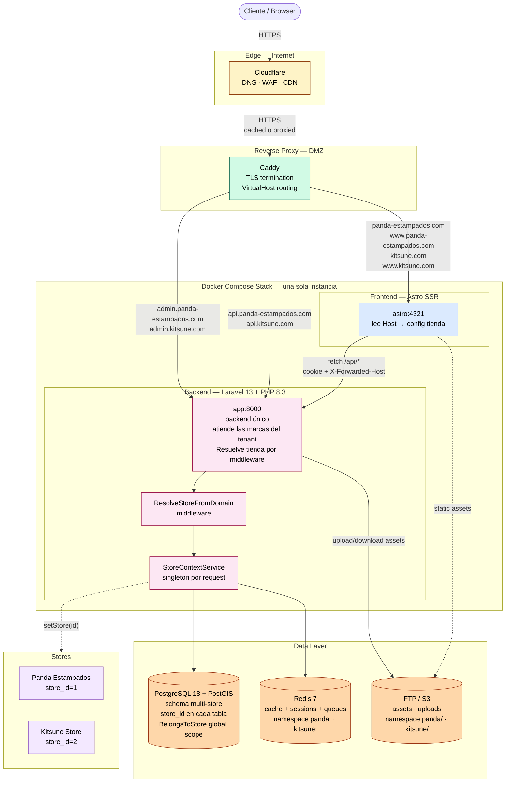
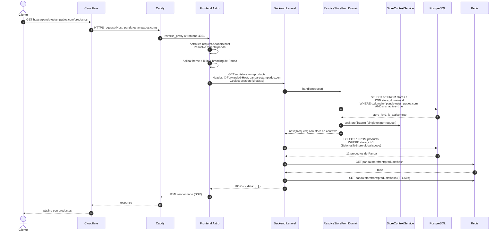
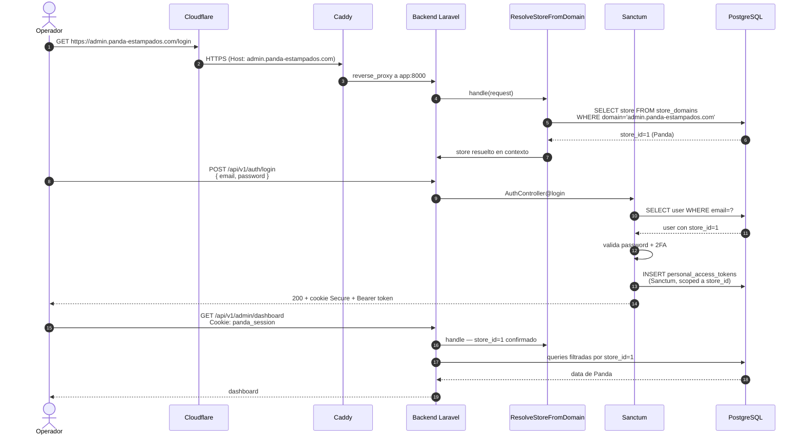
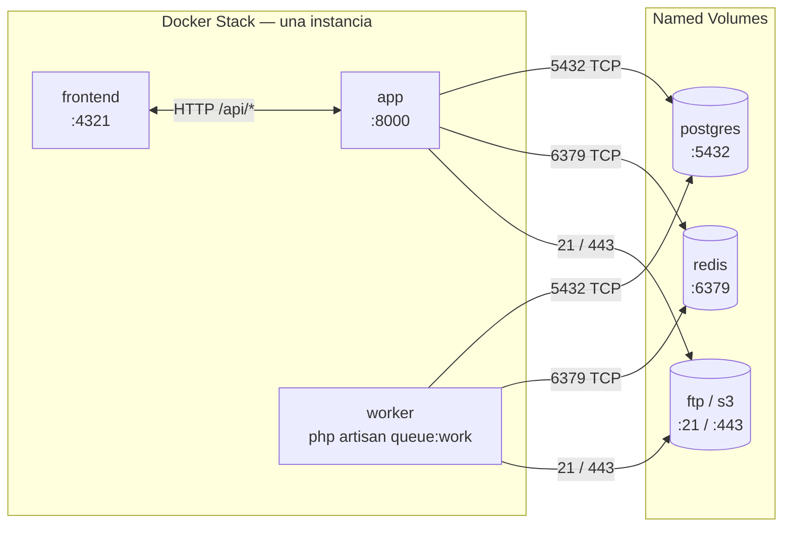

# Flujo Multi-Store — Arquitectura por Instancia

> Última actualización: 2026-09-26
> Stack: Docker / Caddy / Laravel 13 / Astro 7 /
> PostgreSQL 18 / Redis

Este documento describe el flujo de requests en AtlasCommerce
considerando la arquitectura multi-instancia desplegada. Cada
instancia `docker/instances/<stage>/<store>/` es una unidad
aislada con su propia BD, Redis, backend y frontend. Multi-store
opera dentro de una misma instancia cuando el dueño comparte
operación entre marcas (caso Panda Estampados + Kitsune). Multi-
instancia aísla tiendas de dueños distintos en servidores
separados.

---

## 1. Topología de despliegue

Una sola instancia Docker atiende los dominios de su tenant.
El routing por dominio se resuelve en el edge (Caddy) y se
enriquece en el backend vía middleware. Las instancias `mm-
boutique` y `morales-store` exponen dominios únicos; la
instancia `panda-estampados-and-kitsune` sirve dos marcas
(Panda Estampados y Kitsune Store) bajo una sola API.

Las instancias `mm-boutique` y `morales-store` siguen el mismo
patrón pero con dominios únicos:

- `mm-boutique.com`, `www.mm-boutique.com`, `admin.mm-boutique.com`.
- `morales-store.com`, `www.morales-store.com`,
  `admin.morales-store.com`.

Cada instancia es una unidad aislada: BD propia, Redis propio,
FTP propio. Ver [operations/deployment.md](../operations/deployment.md
"operations/deployment.md") para el detalle de despliegue.

---

## 2. Flujo de request — Storefront

Cómo se resuelve una visita a `panda-estampados.com/productos`:

**Punto clave:** la línea `WHERE store_id=1` **no la escribió
ningún developer**. La inyecta el global scope del trait
`BelongsToStore`. Si olvidás el trait, Laravel no filtra y
rompes el aislamiento. Por eso el `MultiTenantHttpIsolationTest`
es crítico.

Para instancias single-store (MM Boutique, Morales Store) el
mismo flujo aplica pero la BD solo conoce un `store_id`. El
middleware `ResolveStoreFromDomain` valida que el dominio
entrante pertenezca al tenant activo.

---

## 3. Flujo de request — Admin

Cómo se resuelve un login en `admin.panda-estampados.com`:

**Diferencia con storefront:** el admin fija el `store_id`
**dos veces**: una por el dominio (`ResolveStoreFromDomain`)
y otra por el usuario logueado (campo `users.store_id`). Si
no coinciden, **se rechaza el request**. Esto evita que un
operador de Kitsune entre a `admin.panda-estampados.com`.

---

## 4. Conexiones entre servicios (Docker Compose)

> Los **Secrets** (DB password, Redis password, FTP creds)
> viven en `docker/instances/<stage>/<store>/environment/.env`
> montados como variables de entorno en cada container. Nunca
> en código ni en archivos versionados.

En **dev** la capa HTTP está separada: existe un sidecar
`nginx` (`:8000`) entre Caddy y el FPM (`backend:9000`). En
**producción** la imagen `app` ya trae `php-fpm` + nginx
unificados en un solo puerto `:8000`. Ver
[operations/deployment.md](../operations/deployment.md
"operations/deployment.md") para la diferencia concreta.

---

## 5. Decisiones clave del diseño

| Decisión                                                  | Por qué                                                                                                                |
| --------------------------------------------------------- | ---------------------------------------------------------------------------------------------------------------------- |
| **1 backend, 1 frontend, N tiendas**                      | El 95% del código es idéntico. Multi-instance es duplicar operaciones, no valor.                                       |
| **Subdominio admin por tienda**                           | Cookies aisladas, deploy independiente, branding distinto, seguridad reforzada.                                        |
| **PostgreSQL compartido con `store_id` (dentro de stack)**| Una sola fuente de verdad por instancia. El global scope del trait aísla los datos.                                    |
| **Redis compartido con namespaces**                       | `panda:cart:123` y `kitsune:cart:123` conviven sin colisión. Invalidación cross-tenant no es problema porque no existe. |
| **FTP único con prefijos**                                | Los assets son archivos. El servidor no sabe de tiendas. Los nombres de archivo lleva la tienda.                       |
| **Middleware resuelve tienda por host**                   | Single source of truth para el store activo en cada request.                                                           |
| **Wildcard TLS `*.panda-estampados.com`** + `*.kitsune.com` | Un cert cubre storefront + admin por marca. Renovación automática con Caddy + Cloudflare.                            |

---

## 6. Lo que falta para llegar a producción

1. ✅ **Caddyfile** con los virtualhosts para cada dominio real —
   `docker/caddy/Caddyfile` (uno solo compartido entre instancias).
2. ✅ **Seeder `store_domains`** cargando `panda-estampados.com`,
   `admin.panda-estampados.com`, `kitsune.com`, `admin.kitsune.com`,
   `mm-boutique.com`, `admin.mm-boutique.com`, `morales-store.com`,
   `admin.morales-store.com`, `www.*`, etc. — vía
   `tenants:bootstrap seeds/<store>.json`.
3. ✅ **Campo `users.store_id`** con FK a `stores.id`.
4. 🔄 **Middleware/Policy** que valida que
   `users.store_id === store_context.store_id` antes de cualquier
   acción admin. Verificar cobertura en `policies/` por store.
5. ✅ **Astro middleware** que lee el `Host` del request y expone
   el tenant al SSR — `src/middleware.ts` con
   `detectTenantFromHost`.
6. ⏳ **Backups automatizados** de Postgres y Redis (cron + S3).
   Ver [operations/backups.md](../operations/backups.md
   "operations/backups.md").
7. ⏳ **Monitoreo** con Prometheus + Grafana (métricas de
   latencia por tienda). Stack aún no configurado.

## Decisiones arquitectónicas vinculadas

- [architecture/overview.md](overview.md "architecture/overview.md")
  — Diagrama del sistema actual.
- [architecture/multi-store.md](multi-store.md
  "architecture/multi-store.md") — Multi-store design dentro de
  una instancia.
- [architecture/decisions.md](decisions.md "architecture/decisions.md")
  — ADRs.
