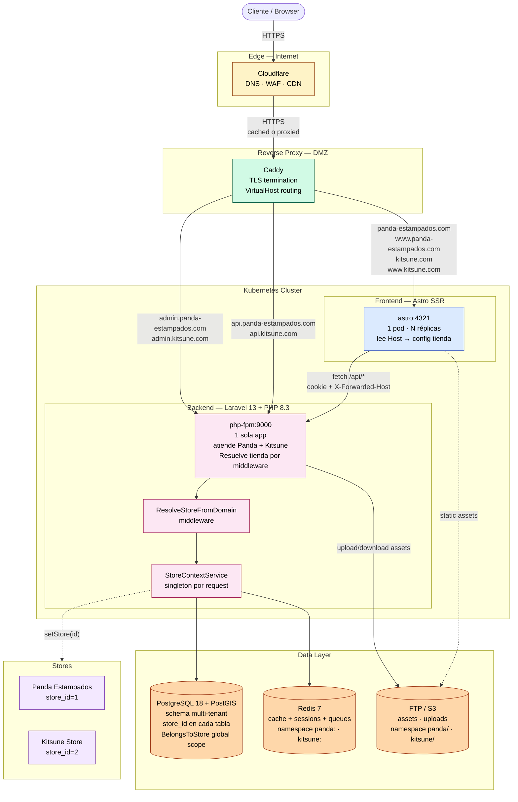
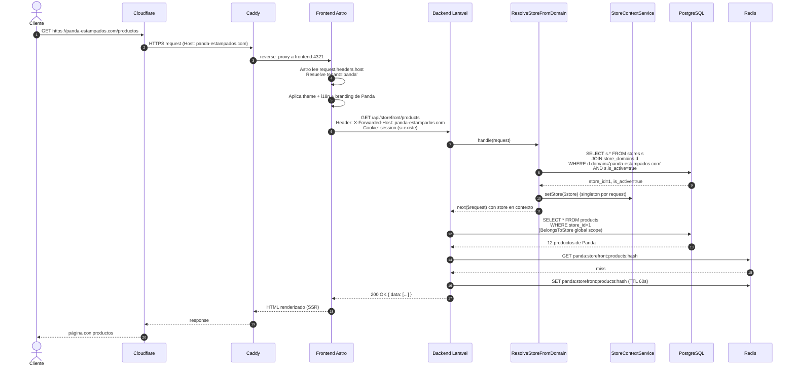
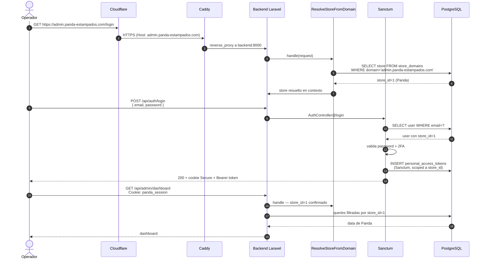
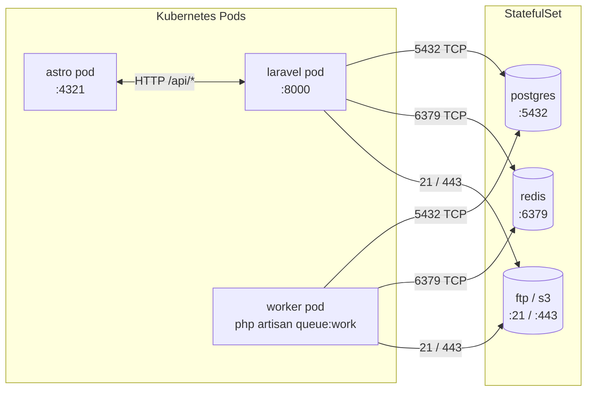

# Flujo Multi-Tienda — Arquitectura Final

> Última actualización: 2027-08-01
> Stack: Docker / Kubernetes / Caddy / Laravel 13 / Astro 7 /
> PostgreSQL 18 / Redis

---

## 1. Topología de despliegue

Una sola instancia de cada servicio atienda ambas tiendas. El routing por
dominio se resuelve en el edge (Caddy) y se enriquece en el backend vía
middleware.

---

## 2. Flujo de request — Storefront

Cómo se resuelve una visita a `panda-estampados.com/productos`:

**Punto clave:** la línea `WHERE store_id=1` **no la escribió ningún
developer**. La inyecta el global scope del trait `BelongsToStore`. Si
olvidás el trait, Laravel no filtra y rompes el aislamiento. Por eso
el `MultiTenantHttpIsolationTest` es crítico.

---

## 3. Flujo de request — Admin

Cómo se resuelve un login en `admin.panda-estampados.com`:

**Diferencia con storefront:** el admin fija el `store_id` **dos
veces**: una por el dominio (`ResolveStoreFromDomain`) y otra por el
usuario logueado (campo `users.store_id`). Si no coinciden, **se
rechaza el request**. Esto evita que un operador de Kitsune entre a
`admin.panda-estampados.com`.

---

## 4. Conexiones con servicios

| Servicio       | Quién lo usa       | Protocolo    | Datos que pasan                              |
| -------------- | ------------------ | ------------ | -------------------------------------------- |
| **Cloudflare** | Caddy              | HTTPS        | Request/response. Headers, cookies, body.    |
| **Caddy**      | Frontend / Backend | HTTP interno | Host header, X-Forwarded-Proto, X-Real-IP.   |
| **Frontend**   | Backend            | HTTP/HTTPS   | Fetch API. Cookies Sanctum. Header `Host`.   |
| **Backend**    | PostgreSQL         | TCP 5432     | Credenciales `.env`. Queries parametrizadas. |
| **Backend**    | Redis              | TCP 6379     | `REDIS_PASSWORD`. Sesiones, cache, queues.   |
| **Backend**    | FTP / S3           | FTP/S3       | Credenciales en `.env`. Assets binarios.     |
| **Frontend**   | FTP / S3           | HTTPS        | Solo assets públicos vía CDN.                |

### Conexiones K8s internas

> Los **Secrets** (DB password, Redis password, FTP creds) viven en
> K8s Secrets montados como variables de entorno en cada pod. Nunca en
> código ni en ConfigMaps.

---

## 5. Decisiones clave del diseño

| Decisión                                   | Por qué                                                                                                                 |
| ------------------------------------------ | ----------------------------------------------------------------------------------------------------------------------- |
| **1 backend, 1 frontend, N tiendas**       | El 95% del código es idéntico. Multi-instance es duplicar operaciones, no valor.                                                |
| **Subdominio admin por tienda**            | Cookies aisladas, deploy independiente, branding distinto, seguridad reforzada.                                         |
| **PostgreSQL compartido con `store_id`**   | Una sola fuente de verdad. El global scope del trait aísla los datos.                                                   |
| **Redis compartido con namespaces**        | `panda:cart:123` y `kitsune:cart:123` conviven sin colisión. Invalidación cross-tenant no es problema porque no existe. |
| **FTP único con prefijos**                 | Los assets son archivos. El servidor no sabe de tiendas. Los nombres de archivo lleva la tienda.                          |
| **Middleware resuelve tienda por host**    | Single source of truth para el store activo en cada request.                                                            |
| **Wildcard TLS `*.panda-estampados.com`** | Un cert cubre storefront + admin. Renovación automática con Caddy + Cloudflare.                                         |

---

## 6. Lo que falta para llegar a producción

1. **Caddyfile** con los virtualhosts para cada dominio real.
2. **Seeder `store_domains`** cargando `panda-estampados.com`,
   `admin.panda-estampados.com`, `kitsune.com`,
   `admin.kitsune.com`, `www.*`, etc.
3. **Campo `users.store_id`** con FK a `stores.id`.
4. **Middleware/Policy** que valida que
   `users.store_id === store_context.store_id` antes de cualquier
   acción admin.
5. **Astro middleware** que lee el `Host` del request y expone el tenant al SSR.
6. **HPA en K8s** para escalar `astro` y `laravel` independientemente.
7. **Backups automatizados** de Postgres y Redis (cron + S3).
8. **Monitoreo** con Prometheus + Grafana (métricas de latencia por tienda).
