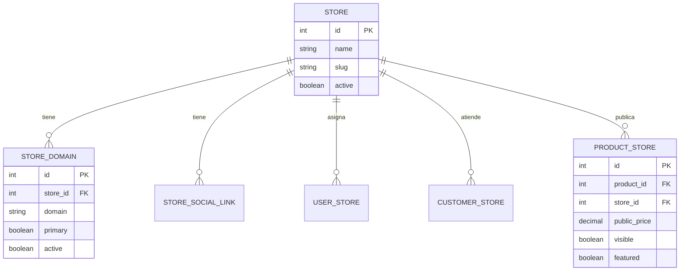

# Arquitectura Multi-Tienda

## Problema que resuelve

Panda Estampados y Kitsune son dos marcas
comerciales con identidad, público y catálogo
distintos, pero comparten operaciones, inventario
y administración. El sistema debe presentar dos
tiendas independientes para el cliente final
mientras mantiene una plataforma unificada para
el dueño.

## Definiciones

- **Store (Tienda)** — Entidad que representa una
  marca comercial. Tiene nombre, logo, colores,
  configuración y dominios asociados.
- **StoreDomain** — Dominio o subdominio apuntando
  a una tienda. Un store puede tener múltiples
  dominios.
- **StoreSocialLink** — Redes sociales asociadas
  a una tienda (Instagram, Facebook, WhatsApp,
  etc.).
- **ProductStore** — Relación entre un producto y
  una tienda. Controla si un producto está visible,
  a qué precio se publica y su orden de aparición.
- **UserStore** — Relación entre un usuario
  administrativo, una tienda y un rol específico
  dentro de esa tienda. Determina qué tienda puede
  administrar y con qué permisos.
- **CustomerStore** — Relación entre un cliente y
  una tienda. Clasifica clientes por tienda de
  origen.
- **SalesChannel** — Canal de venta: Web,
  WhatsApp, Instagram, Admin, tienda física.

## Las dos tiendas

### Panda Estampados

```txt
Dominio:    panda-estampados.com
Público:    Empresas, clientes mayoristas
            /corporativos
Productos:  Personalizados, merchandising
            empresarial, regalos corporativos,
            textiles, tazas, artículos promocionales
Enfoque:    B2B, pedidos grandes, cotizaciones
```

### Kitsune Store

```txt
Dominio:    kitsune.com (o kitsune-store.com)
Público:    Clientes habituales/minoristas
Productos:  Anime, videojuegos, cultura japonesa,
            productos personalizados
Enfoque:    B2C, pedidos individuales, experiencia
            de compra
```

## Qué se comparte

- **Backend API** — Una sola `API` centraliza
  toda la lógica
- **Base de datos** — Shared database con
  `store_id` para filtrado
- **Inventario** — Mismo almacén, mismo stock
  para ambas tiendas
- **Panel administrativo** — Un solo admin gestiona
  ambas tiendas
- **Usuarios admin** — Los mismos usuarios pueden
  administrar ambas tiendas
- **Roles y permisos** — Sistema de roles global
- **Métodos de pago** — Mismos métodos de pago
  disponibles
- **Empresas de envío** — Mismas empresas de envío
- **Impuestos** — Mismas reglas de impuestos
- **Monedas** — Configuración de monedas global

## Qué se separa

- **Catálogo público** — `product_stores` controla
  qué productos aparecen en cada tienda
- **Precio público** —
  `PRODUCTO_TIENDA.precio_publico` →
  `product_stores.public_price` override por tienda
- **Descripción pública** —
  `PRODUCTO_TIENDA.descripcion_publica` →
  `product_stores.public_description` override
  por tienda
- **Redes sociales** — `store_social_links` por
  tienda
- **Dominios** — `store_domains` por tienda
- **Cupones** — `coupons.store_id` — cupones por
  tienda
- **Promociones** — `promotions.store_id` —
  promociones por tienda
- **Pedidos** — `orders.store_id` — pedidos por
  tienda
- **Facturas** — `invoices.store_id` — facturas
  por tienda
- **Carritos** — `carts.store_id` — carritos por
  tienda
- **Wishlists** — `wishlists.store_id` — wishlists
  por tienda
- **Reseñas** — `product_reviews.store_id` —
  reseñas por tienda
- **Preguntas** — `product_questions.store_id` —
  preguntas por tienda
- **Tickets soporte** — `support_tickets.store_id`
  — tickets por tienda
- **Notificaciones** — `notifications.store_id` —
  notificaciones por tienda
- **Auditorías** — `audits.store_id` — auditorías
  por tienda
- **Reportes** — Filtrados por `store_id` en el
  panel admin

## Cómo funciona el filtrado por tienda

### En el storefront (público)

El frontend resuelve la tienda actual a partir del
dominio de origen:

```txt
panda-estampados.com → Store{id: 1, name: "Panda Estampados"}
kitsune.com           → Store{id: 2, name: "Kitsune Store"}
```

Todas las peticiones al backend incluyen el
contexto de tienda. El backend filtra los datos
automáticamente.

### En el panel administrativo

El administrador selecciona qué tienda está
gestionando. Un selector de tienda en el header
permite cambiar entre Panda y Kitsune. Los datos
mostrados se filtran según la tienda seleccionada.

### En el backend `API`

El middleware `ResolveStoreFromDomain` resuelve la
tienda actual a partir del dominio en las rutas
públicas. En el admin, se usa un parámetro
`store_id` o header `X-Store-Id`.

## Modelo de datos multi-tienda

### Entidades con `store_id`

```txt
product_stores     → qué productos publica cada tienda
orders              → pedidos por tienda
invoices            → facturas por tienda
carts               → carritos por tienda
wishlists           → wishlists por tienda
coupons             → cupones por tienda
promotions          → promociones por tienda
product_reviews     → reseñas por tienda
product_questions   → preguntas por tienda
support_tickets     → tickets por tienda
notifications       → notificaciones por tienda
audits              → auditorías por tienda
```

### Entidades sin `store_id` (globales)

```txt
users               → usuarios globales (asociados vía user_stores)
roles               → roles globales
permissions         → permisos globales
currencies          → monedas globales
brands              → marcas globales
categories          → categorías globales
warehouses          → almacenes globales (inventario compartido)
payment_methods     → métodos de pago globales
shipping_companies  → empresas de envío globales
taxes               → impuestos globales
```

### Entidades de relación

```txt
store_domains       → dominios por tienda
store_social_links  → redes sociales por tienda
user_stores         → qué usuarios administra qué tienda
customer_stores     → qué clientes pertenecen a qué tienda
product_stores      → publicación de productos por tienda
sales_channels      → canales de venta
```

## Flujo completo de una compra

### Desde storefront (cliente)

```txt
1. Cliente visita kitsune.com
2. Frontend resuelve Store{id: 2} desde el dominio
3. GET /api/products?store_id=2 → productos visibles
4. Cliente agrega producto al carrito
5. POST /api/carts { store_id: 2, product_id: 15 }
6. Cliente realiza checkout
7. POST /api/orders { store_id: 2, ... }
   → orders.user_creator_id = null (cliente)
8. POST /api/invoices { store_id: 2, order_id: 100 }
   → invoices.user_issuer_id = null (automático)
9. Pago procesado, stock actualizado (global)
10. Factura generada con store_id=2
```

### Desde panel administrativo

```txt
1. Admin selecciona tienda Panda
2. Envía header X-Store-Id: 1
3. Crea pedido para un cliente
4. POST /api/orders { store_id: 1, ... }
   → orders.user_creator_id = admin.id
5. Emite factura
6. POST /api/invoices { store_id: 1, order_id: 50 }
   → invoices.user_issuer_id = admin.id
7. El sistema puede rastrear quién creó cada
   pedido y quién emitió cada factura
```

## Consideraciones de diseño

### Inventario compartido

El inventario es global porque ambas tiendas venden
del mismo almacén. Si Panda vende 5 camisetas y
Kitsune vende 3 del mismo producto, el stock se
reduce en 8 unidades totales.

Esto es correcto para la operación actual. Si en
el futuro se necesita inventario separado por
tienda, se debería crear una tabla
`warehouse_stores` o similar.

### Precio por tienda

Un mismo producto puede tener diferente precio
público en cada tienda. Esto se controla mediante
`product_stores.public_price`. El precio base
del producto (`products.price`) es el precio de
referencia o costo.

### Permisos por tienda

Un usuario administrador puede estar asignado a
una sola tienda (solo Panda), a ambas tiendas, o
ser admin global (ve todo). Esto se controla
mediante la tabla `user_stores`, que además define
el rol del usuario dentro de cada tienda.

Un usuario puede tener diferente rol por tienda
mediante `user_stores.role_id`:

```txt
Usuario: Carlos

Panda:
  - Rol: Facturador
  - Puede crear pedidos y emitir facturas

Kitsune:
  - Rol: Supervisor
  - Puede revisar operaciones, pero no
    necesariamente emitir facturas
```

### Trazabilidad administrativa

Cuando un pedido o factura se crea desde el panel
administrativo, el sistema registra qué usuario
realizó la operación:

```txt
orders.user_creator_id
  → Usuario que creó el pedido desde el admin
  → Puede ser null si el cliente creó el pedido
    desde storefront

invoices.user_issuer_id
  → Usuario que emitió la factura
  → Permite saber quién generó la factura
```

Estos campos no reemplazan la auditoría. Son
complementos para trazabilidad comercial directa.

## Diagrama de entidades multi-tienda


