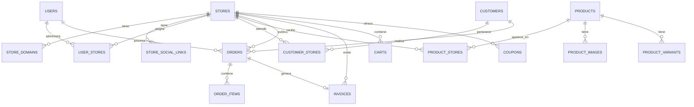

# Modelo de Datos Multi-Store

## Visión general

El modelo de datos soporta una plataforma ecommerce multi-store
desplegada como **3 instancias independientes** (ver
[architecture/overview.md](../architecture/overview.md
"architecture/overview.md")). Cada instancia tiene su propia
base de datos `PostgreSQL`. Dentro de la instancia
`panda-estampados-and-kitsune` conviven dos marcas (`Panda
Estampados` y `Kitsune Store`) que comparten backend, BD e
inventario pero presentan catálogos, pedidos y reportes
separados vía `store_id`. Panda y Kitsune son tiendas diferentes
para el cliente, pero forman parte de una misma operación
administrativa. Las instancias `mm-boutique` y
`morales-store` son single-brand — el `store_id` se mantiene
en esquema pero apunta siempre a la misma marca.

## Principios del modelo

1. **BD por instancia** — Cada stack Docker tiene su propia
   instancia `PostgreSQL` (`docker/instances/<stage>/<store>/
   conf/postgres/`). Las instancias no comparten BD.
2. `store_id` como filtro dentro de la instancia — Las tablas
   transaccionales incluyen `store_id` para aislamiento por
   marca cuando la instancia atiende varias.
3. **Productos globales dentro de la instancia** — Los
   productos son entidades globales dentro de la BD. Se
   publican selectivamente en marcas vía `product_stores`.
4. **Inventario global dentro de la instancia** — El stock es
   compartido entre marcas de la misma instancia.
5. **Roles por marca** — Cada usuario puede tener un rol
   distinto por marca mediante `user_stores.role_id`.

## Entidades multi-tienda

### Store (Tienda)

Entidad raíz del sistema multi-tienda. Representa una marca
comercial.

```txt
stores
├── id                  PK
├── currency_id         FK → currencies
├── name                string ("Panda Estampados", "Kitsune Store")
├── slug                string (unique)
├── logo                string (URL)
├── email               string
├── phone               string
├── whatsapp            string
├── address             string
├── description         text
├── primary_color       string (hex)
├── secondary_color     string (hex)
├── maintenance         boolean
├── active              boolean
├── created_at          timestamp
└── updated_at          timestamp
```

### StoreDomain (Dominio de tienda)

Dominios DNS que apuntan a una tienda. Un store puede tener
múltiples dominios.

```txt
store_domains
├── id                  PK
├── store_id            FK → stores
├── domain              string (unique)
├── primary             boolean
├── active              boolean
└── created_at          timestamp
```

Ejemplo:

- `store_id: 1` — `panda-estampados.com` (primary: true)
- `store_id: 2` — `kitsune.com` (primary: true)
- `store_id: 2` — `kitsune-store.com` (redirect, primary: false)

### StoreSocialLink (Red social de tienda)

Redes sociales asociadas a una tienda.

```txt
store_social_links
├── id                  PK
├── store_id            FK → stores
├── platform            string (instagram, facebook, whatsapp, tiktok)
├── url                 string
├── active              boolean
└── created_at          timestamp
```

### ProductStore (Publicación de producto en tienda)

Relación N:N entre productos y tiendas. Controla qué productos
aparecen en cada tienda, con precio y descripción propios.

```txt
product_stores
├── id                  PK
├── product_id          FK → products
├── store_id            FK → stores
├── slug                string (URL amigable por tienda)
├── public_price        decimal (precio público, override del price base)
├── public_description  text (descripción específica por tienda)
├── visible             boolean
├── featured            boolean
├── sort_order          int
├── published_at        timestamp
├── created_at          timestamp
└── updated_at          timestamp
```

### UserStore (Usuario admin por tienda)

Asocia usuarios administradores con las tiendas que pueden
gestionar. Incluye el rol específico del usuario dentro
de cada tienda.

```txt
user_stores
├── id                  PK
├── user_id             FK → users
├── store_id            FK → stores
├── role_id             FK → roles
├── active              boolean
├── assigned_at         timestamp
├── created_at          timestamp
└── updated_at          timestamp
```

El campo `role_id` define el rol del usuario
específicamente dentro de esa tienda. Un usuario puede
tener un rol diferente por tienda.

### CustomerStore (Cliente por tienda)

Clasifica clientes por tienda de origen o preferencia.

```txt
customer_stores
├── id                  PK
├── customer_id         FK → customers
├── store_id            FK → stores
├── customer_type       string (retail, wholesale, corporate)
├── active              boolean
└── created_at          timestamp
```

### SalesChannel (Canal de venta)

Define los canales por los cuales se realizan ventas.

```txt
sales_channels
├── id                  PK
├── name                string (Web, WhatsApp, Instagram, Admin, Physical Store)
├── description         text
├── active              boolean
└── created_at          timestamp
```

## Entidades transaccionales con `store_id`

Estas tablas incluyen `store_id` para filtrar datos por tienda:

```txt
orders              → pedidos por tienda
invoices            → facturas por tienda
carts               → carritos por tienda
wishlists           → wishlists por tienda
coupons             → cupones por tienda
promotions          → promociones por tienda
product_reviews     → reseñas por tienda
product_questions   → preguntas por tienda
support_tickets     → tickets por tienda
notifications       → notificaciones por tienda
audits              → auditorías por tienda
payments            → pagos por tienda
store_settings      → configuración por tienda
```

## Entidades globales (sin `store_id` dentro de la instancia)

Estas tablas NO incluyen `store_id` porque son compartidas
entre marcas dentro de la misma instancia Docker. **No se
comparten entre instancias** — cada stack tiene su propia
copia de estas tablas con datos independientes para su(s)
marca(s):

```txt
users               → usuarios globales
roles               → roles globales
permissions         → permisos globales
currencies          → monedas
exchange_rates      → tipos de cambio
brands              → marcas
categories          → categorías
products            → productos (publicados vía product_stores)
product_images      → imágenes de productos
product_variants    → variantes
attribute_product   → valores de atributos por producto (pivot)
attribute_variant   → valores de atributos por variante (pivot)
attributes          → definición de atributos
warehouses          → almacenes (inventario global)
inventories         → stock por almacén-producto
inventory_movements → movimientos de stock
suppliers           → proveedores
purchases           → compras
purchase_items      → líneas de compra
payment_methods     → métodos de pago
shipping_companies  → empresas de envío
shipping_zones      → zonas de envío
taxes               → impuestos
```

## Trazabilidad administrativa

Cuando un pedido o factura se crea desde el panel
administrativo, el sistema registra qué usuario
administrativo realizó la operación.

### `orders.user_creator_id`

Usuario administrativo que creó el pedido desde
el panel. Puede ser `null` si el pedido fue creado
por el cliente desde storefront.

Permite al dueño saber qué usuario generó cada
pedido sin depender únicamente de la auditoría.

### `invoices.user_issuer_id`

Usuario administrativo que emitió la factura.
Permite saber quién generó la factura sin depender
únicamente de la auditoría.

### Equivalencias DER → implementación

```txt
PEDIDO.id_usuario_creador   → orders.user_creator_id
FACTURA.id_usuario_emisor   → invoices.user_issuer_id
USUARIO_TIENDA.id_rol       → user_stores.role_id
```

Estos campos no reemplazan la auditoría. Son
complementos que permiten trazabilidad comercial
directa.

## Relaciones importantes



## Flujo de datos por tienda

### Storefront (público)

```txt
1. GET https://kitsune.com/products
2. Host: kitsune.com → StoreDomain → Store{id: 2}
3. SELECT * FROM product_stores
   WHERE store_id = 2 AND visible = true
4. JOIN products ON products.id = product_stores.product_id
5. Retorna productos visibles en Kitsune con precio público propio
```

### Panel admin

```txt
1. GET /api/orders con header X-Store-Id: 1
2. Middleware resuelve Store{id: 1}
3. SELECT * FROM orders WHERE store_id = 1
4. Retorna solo pedidos de Panda
```

### Inventario (global)

```txt
1. Producto "Camiseta Anime" tiene stock de 100
   en almacén Principal
2. Panda vende 10 → stock actualizado a 90
3. Kitsune vende 5 → stock actualizado a 85
4. El stock es global, se reduce desde el mismo almacén
```

## Inventario compartido vs por tienda

### Estado actual: Global

```txt
inventories
├── id                  PK
├── warehouse_id        FK → warehouses
├── product_id          FK → products
├── variant_id          FK → product_variants (nullable)
├── current_stock       int
├── minimum_stock       int
├── reserved_stock      int
└── (sin store_id)
```

El stock es compartido porque ambas tiendas venden del mismo
almacén. Esto es correcto para la operación actual.

### Futuro: Por tienda (opcional)

Si se necesita inventario separado, se puede crear:

```sql
-- Opción 1: warehouse_store
CREATE TABLE warehouse_stores (
    id SERIAL PRIMARY KEY,
    warehouse_id INT REFERENCES warehouses(id),
    store_id INT REFERENCES stores(id),
    UNIQUE(warehouse_id, store_id)
);

-- Opción 2: stock por tienda en inventories
ALTER TABLE inventories
    ADD COLUMN store_id INT REFERENCES stores(id);
```

**Recomendación:** No implementar esto a menos que la operación
lo requiera explícitamente. El inventario global simplifica la
lógica y evita inconsistencias.

## Integridad referencial

Las migraciones deben definir correctamente las claves foráneas:

```php
Schema::create('orders', function (Blueprint $table) {
    $table->id();
    $table->foreignId('store_id')->constrained();
    $table->foreignId('customer_id')->constrained();
    // ...
});
```

Los índices en `store_id` son críticos para el rendimiento de
las consultas filtradas:

```php
$table->index('store_id');
```

## Nota de regeneración del ER diagram (2026-10-01)

El diagrama visual en
[`docs/database/diagrams/ecommerce-er.mmd`](diagrams/ecommerce-er.mmd
"diagrams/ecommerce-er.mmd") se regeneró a partir del contenido
real de las migraciones Laravel (`Schema::create` y `Schema::table`
en `backend/database/migrations/**` y en
`backend/packages/atlas-commerce-plugin-erp/database/migrations/`).

Resumen del cambio:

- **Total de tablas en el esquema real:** 85 (no 26 como se estimaba
  en el prompt inicial).
- **Tablas eliminadas del diagrama anterior:** `erp_connections`
  (dropped por la migración
  `system/2026_08_10_000001_drop_erp_connections_table.php`).
- **Tablas añadidas al diagrama:** `sessions`, `social_accounts`,
  `passkeys` (vía Laravel Passkeys), `rfq_requests` (storefront,
  B2B), `bulk_cart_items` (carrito B2B).
- **Columnas añadidas via `Schema::table`:** `stores.tax_rate`,
  `invoices.shipping_cents`, `invoices.refunded_cents`,
  `invoices.shipping_zone_id`, `shipping_zones.store_id`,
  `shipping_zones.base_cost_cents` (reemplaza `base_cost`),
  `users.preferred_recovery_method` (con CHECK constraint),
  `customers.anonymized_at`, `customers.deletion_requested_at`,
  `customers.deletion_token_hash`,
  `customers.deletion_token_expires_at` (GDPR, Ley 896 Nicaragua),
  y `two_factor_settings.secret` ensanchado de `varchar(255)` a
  `text`.
- **Política RLS PostgreSQL:** la migración
  `system/2026_08_02_000003_enable_row_level_security.php` aplica
  row-level security sobre 23 tablas operativas multi-tenant (las
  marcadas con `store_id NOT NULL` más `wishlists` y
  `customer_stores`). El diagrama documenta esa capa en el preamble.
- **Multi-tenencia:** dentro del mismo diagrama se distinguen las
  tablas con `store_id NOT NULL` (operacionales) y las globales
  (catálogo, inventario, etc.) vía el preamble.

Esta nota existe para que cualquier lectura cruzada entre este
documento y el diagrama sea honesta: si el diagrama contradice
este texto, el diagrama es la fuente de verdad porque se genera
desde las migraciones reales.
