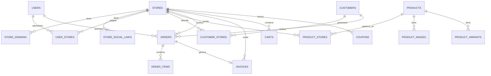

# Modelo de Datos Multi-Tienda

## Visión general

El modelo de datos soporta una plataforma ecommerce multi-tienda
donde dos marcas (`Panda Estampados` y `Kitsune`) comparten
backend, base de datos e inventario, pero presentan catálogos,
pedidos y reportes separados.

## Principios del modelo

1. **Shared database** — Una sola instancia `PostgreSQL` para
   ambas tiendas.
2. `store_id` como filtro — Las tablas transaccionales incluyen
   `store_id` para aislamiento por tienda.
3. **Productos globales** — Los productos son entidades globales.
   Se publican selectivamente en tiendas vía `product_stores`.
4. **Inventario global** — El stock es compartido entre tiendas.
5. **Roles globales** — Los permisos y roles no se duplican
   por tienda.

## Entidades multi-tienda

### Store (Tienda)

Entidad raíz del sistema multi-tienda. Representa una marca
comercial.

```txt
stores
├── id                  PK
├── currency_id         FK → currencies
├── name                string ("Panda Estampados", "Kitsune Store")
├── slug                string (unique)
├── logo                string (URL)
├── email               string
├── phone               string
├── whatsapp            string
├── address             string
├── description         text
├── primary_color       string (hex)
├── secondary_color     string (hex)
├── maintenance         boolean
├── active              boolean
├── created_at          timestamp
└── updated_at          timestamp
```

### StoreDomain (Dominio de tienda)

Dominios DNS que apuntan a una tienda. Un store puede tener
múltiples dominios.

```txt
store_domains
├── id                  PK
├── store_id            FK → stores
├── domain              string (unique)
├── primary             boolean
├── active              boolean
└── created_at          timestamp
```

Ejemplo:

- `store_id: 1` — `pandas-estampados.com` (primary: true)
- `store_id: 2` — `kitsune.com` (primary: true)
- `store_id: 2` — `kitsune-store.com` (redirect, primary: false)

### StoreSocialLink (Red social de tienda)

Redes sociales asociadas a una tienda.

```txt
store_social_links
├── id                  PK
├── store_id            FK → stores
├── platform            string (instagram, facebook, whatsapp, tiktok)
├── url                 string
├── active              boolean
└── created_at          timestamp
```

### ProductStore (Publicación de producto en tienda)

Relación N:N entre productos y tiendas. Controla qué productos
aparecen en cada tienda, con precio y descripción propios.

```txt
product_stores
├── id                  PK
├── product_id          FK → products
├── store_id            FK → stores
├── slug                string (URL amigable por tienda)
├── public_price        decimal (precio público, override del price base)
├── public_description  text (descripción específica por tienda)
├── visible             boolean
├── featured            boolean
├── sort_order          int
├── published_at        timestamp
├── created_at          timestamp
└── updated_at          timestamp
```

### UserStore (Usuario admin por tienda)

Asocia usuarios administradores con las tiendas que pueden
gestionar.

```txt
user_stores
├── id                  PK
├── user_id             FK → users
├── store_id            FK → stores
├── active              boolean
├── assigned_at         timestamp
└── created_at          timestamp
```

### CustomerStore (Cliente por tienda)

Clasifica clientes por tienda de origen o preferencia.

```txt
customer_stores
├── id                  PK
├── customer_id         FK → customers
├── store_id            FK → stores
├── customer_type       string (retail, wholesale, corporate)
├── active              boolean
└── created_at          timestamp
```

### SalesChannel (Canal de venta)

Define los canales por los cuales se realizan ventas.

```txt
sales_channels
├── id                  PK
├── name                string (Web, WhatsApp, Instagram, Admin, Physical Store)
├── description         text
├── active              boolean
└── created_at          timestamp
```

## Entidades transaccionales con `store_id`

Estas tablas incluyen `store_id` para filtrar datos por tienda:

```txt
orders              → pedidos por tienda
invoices            → facturas por tienda
carts               → carritos por tienda
wishlists           → wishlists por tienda
coupons             → cupones por tienda
promotions          → promociones por tienda
product_reviews     → reseñas por tienda
product_questions   → preguntas por tienda
support_tickets     → tickets por tienda
notifications       → notificaciones por tienda
audits              → auditorías por tienda
payments            → pagos por tienda
store_settings      → configuración por tienda
```

## Entidades globales (sin `store_id`)

Estas tablas NO incluyen `store_id` porque son compartidas
entre tiendas:

```txt
users               → usuarios globales
roles               → roles globales
permissions         → permisos globales
currencies          → monedas
exchange_rates      → tipos de cambio
brands              → marcas
categories          → categorías
products            → productos (publicados vía product_stores)
product_images      → imágenes de productos
product_variants    → variantes
product_attributes  → atributos de productos
attributes          → definición de atributos
warehouses          → almacenes (inventario global)
inventories         → stock por almacén-producto
inventory_movements → movimientos de stock
suppliers           → proveedores
purchases           → compras
purchase_items      → líneas de compra
payment_methods     → métodos de pago
shipping_companies  → empresas de envío
shipping_zones      → zonas de envío
taxes               → impuestos
```

## Relaciones importantes



## Flujo de datos por tienda

### Storefront (público)

```txt
1. GET https://kitsune.com/products
2. Host: kitsune.com → StoreDomain → Store{id: 2}
3. SELECT * FROM product_stores
   WHERE store_id = 2 AND visible = true
4. JOIN products ON products.id = product_stores.product_id
5. Retorna productos visibles en Kitsune con precio público propio
```

### Panel admin

```txt
1. GET /api/orders con header X-Store-Id: 1
2. Middleware resuelve Store{id: 1}
3. SELECT * FROM orders WHERE store_id = 1
4. Retorna solo pedidos de Panda
```

### Inventario (global)

```txt
1. Producto "Camiseta Anime" tiene stock de 100
   en almacén Principal
2. Panda vende 10 → stock actualizado a 90
3. Kitsune vende 5 → stock actualizado a 85
4. El stock es global, se reduce desde el mismo almacén
```

## Inventario compartido vs por tienda

### Estado actual: Global

```txt
inventories
├── id                  PK
├── warehouse_id        FK → warehouses
├── product_id          FK → products
├── variant_id          FK → product_variants (nullable)
├── current_stock       int
├── minimum_stock       int
├── reserved_stock      int
└── (sin store_id)
```

El stock es compartido porque ambas tiendas venden del mismo
almacén. Esto es correcto para la operación actual.

### Futuro: Por tienda (opcional)

Si se necesita inventario separado, se puede crear:

```sql
-- Opción 1: warehouse_store
CREATE TABLE warehouse_stores (
    id SERIAL PRIMARY KEY,
    warehouse_id INT REFERENCES warehouses(id),
    store_id INT REFERENCES stores(id),
    UNIQUE(warehouse_id, store_id)
);

-- Opción 2: stock por tienda en inventories
ALTER TABLE inventories
    ADD COLUMN store_id INT REFERENCES stores(id);
```

**Recomendación:** No implementar esto a menos que la operación
lo requiera explícitamente. El inventario global simplifica la
lógica y evita inconsistencias.

## Integridad referencial

Las migraciones deben definir correctamente las claves foráneas:

```php
Schema::create('orders', function (Blueprint $table) {
    $table->id();
    $table->foreignId('store_id')->constrained();
    $table->foreignId('customer_id')->constrained();
    // ...
});
```

Los índices en `store_id` son críticos para el rendimiento de
las consultas filtradas:

```php
$table->index('store_id');
```
