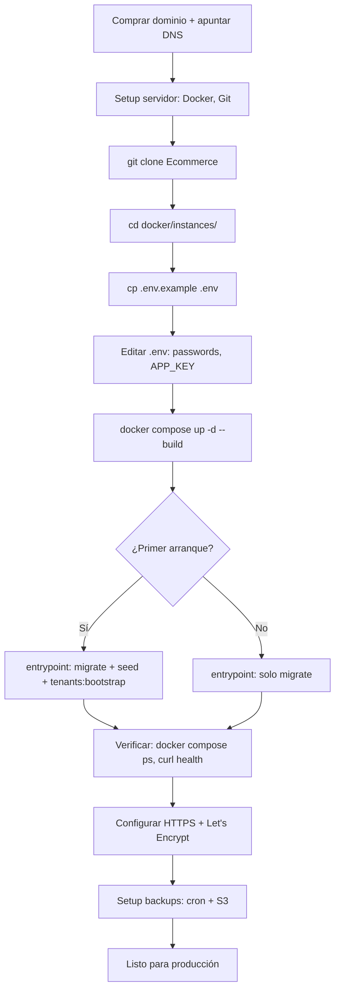

# Deploy Multi-Instance — Workflow por Instancia

> Guía paso a paso para deployar una instancia del sistema en un
> servidor nuevo. Asume que ya tenés el repo clonado y un servidor
> con Docker instalado.

---

## Vista general

Cada instancia se deploya independientemente:

| Instancia | Servidor | Tiendas |
| --------- | -------- | ------- |
| `panda-kitsune/` | Server A (cliente) | Panda + Kitsune |
| `mm-boutique/` | Server B (mamá) | MM Boutique |
| `morales-store/` | Server C (tía) | Morales Store |

Cada servidor corre un único `docker compose up` con la instancia
correspondiente. La base de código es la misma; lo que cambia es el
`.env` y el `seeds/*.json`.

---

## Pre-requisitos del servidor

```bash
# Docker y Docker Compose v2
sudo apt install docker.io docker-compose-v2

# Git
sudo apt install git

# Curl, jq, vim (utilidades varias)
sudo apt install curl jq vim

# Verificar versiones
docker --version          # >= 24.x
docker compose version    # >= 2.x
git --version
```

Puertos expuestos al público (uno por servidor):

| Puerto | Servicio | Caddy |
| ------ | -------- | ----- |
| 80 | HTTP | sí (redirect a HTTPS en prod) |
| 443 | HTTPS | sí (certificados Let's Encrypt automáticos) |

Puertos internos (no expuestos al público):

| Puerto | Servicio | Container |
| ------ | -------- | --------- |
| 8000 | Backend Laravel | `app` |
| 4321 | Frontend Astro | `frontend` |
| 5432 | PostgreSQL | `db` |
| 6379 | Redis | `redis` |

---

## Workflow de deploy — primera vez

### 1. Clonar el repo

```bash
sudo mkdir -p /opt/ecommerce
sudo chown $USER:$USER /opt/ecommerce
cd /opt/ecommerce
git clone https://github.com/D4nitrix13/Ecommerce.git
cd Ecommerce
```

### 2. Configurar la instancia

```bash
cd docker/instances/mm-boutique   # o la instancia que corresponda

# Copiar template de variables de entorno
cp .env.example .env

# Editar .env: cambiar TODOS los valores CAMBIAR_*
$EDITOR .env
```

Valores críticos a cambiar en `.env`:

```env
APP_KEY=                     # Generar con: docker run --rm -it \
                             # ecommerce-core-app:latest \
                             # php artisan key:generate --show
DB_PASSWORD=                 # Password seguro de Postgres
PANDA_ADMIN_PASSWORD=        # Password del admin de la tienda
                             # (cambia el nombre de la variable según instancia:
                             # MM_ADMIN_PASSWORD, MORALES_ADMIN_PASSWORD)
```

Generar `APP_KEY`:

```bash
# Levantar solo el backend momentáneamente para generar la key
docker compose run --rm app php artisan key:generate --show
```

### 3. Levantar los servicios

```bash
docker compose up -d --build
```

El primer arranque tarda más (build de imágenes). El entrypoint:

1. Espera a que Postgres esté listo.
2. Genera `APP_KEY` si no existe.
3. Corre migraciones.
4. Corre seeders (currencies + permissions).
5. Corre `tenants:bootstrap` con el JSON de `seeds/`.
6. Arranca PHP-FPM.

Ver el progreso:

```bash
docker compose logs -f app
```

### 4. Verificar

```bash
# Estado de los servicios
docker compose ps

# Health check del backend
curl -I http://localhost:8000/up
# HTTP/1.1 200 OK

# Health check del frontend
curl -I http://localhost:4321/
# HTTP/1.1 302 Found (redirect a /es)

# Health check de Caddy
curl -I http://localhost/
# HTTP/1.1 200 OK
```

### 5. Configurar DNS

Para cada dominio de la instancia, apuntar al servidor:

```dns
# Ejemplo para mm-boutique.com
A   mm-boutique.com         <IP-SERVER>
A   www.mm-boutique.com     <IP-SERVER>
A   admin.mm-boutique.com   <IP-SERVER>
```

En el registrador de dominios (Cloudflare, Namecheap, etc.), agregar
estos registros A.

---

## Workflow de deploy — actualizaciones

```bash
ssh usuario@servidor
cd /opt/ecommerce/Ecommerce

# Traer últimos cambios
git pull

# Rebuild + restart
cd docker/instances/<instancia>
docker compose pull
docker compose up -d --build
```

Si hay migraciones nuevas:

```bash
docker compose exec app php artisan migrate --force
```

Si hay cambios en `seeds/*.json`:

```bash
docker compose exec app php artisan tenants:bootstrap seeds/<archivo>.json
```

---

## HTTPS con Let's Encrypt (producción)

En el `Caddyfile` de cada instancia, **quitar** la línea `auto_https off`
y dejar que Caddy gestione los certificados automáticamente:

```caddyfile
{
    email ops@example.com   # Email para Let's Encrypt
}

https:// {
    @hostnames host mm-boutique.com www.mm-boutique.com \
                       admin.mm-boutique.com

    handle @hostnames {
        @api path /api/*
        handle @api {
            reverse_proxy app:8000
        }
        handle {
            reverse_proxy frontend:4321
        }
    }

    handle {
        respond "Not found" 404
    }
}
```

Caddy automáticamente:

- Obtiene certificados de Let's Encrypt vía HTTP-01 challenge.
- Los renueva antes de expirar.
- Redirige HTTP a HTTPS.

Para que Let's Encrypt emita certificados, **el puerto 80 debe estar
abierto al público** y el dominio debe apuntar al servidor.

DNS-01 challenge (alternativa para wildcards):

Si usás DNS-01, agregás el módulo de tu proveedor en el Caddyfile:

```caddyfile
{
    email ops@example.com
    acme_dns cloudflare {env.CLOUDFLARE_API_TOKEN}
}
```

---

## Backups

### Automático con cron

Cada servidor tiene su propio cron job que dumpa la BD a S3:

```bash
# /etc/cron.d/ecommerce-backup
0 3 * * * root /opt/ecommerce/Ecommerce/docker/instances/<instancia>/backup.sh >> /var/log/ecommerce-backup.log 2>&1
```

Script `backup.sh` (crear en cada instancia):

```bash
#!/bin/sh
set -e

cd /opt/ecommerce/Ecommerce/docker/instances/<instancia>

# Nombre del archivo
TIMESTAMP=$(date +%Y%m%d-%H%M%S)
BACKUP_FILE="/tmp/ecommerce-${TIMESTAMP}.sql.gz"

# Dump de la BD
docker compose exec -T db pg_dump -U ${DB_USERNAME} ${DB_DATABASE} | gzip > "$BACKUP_FILE"

# Push a S3
aws s3 cp "$BACKUP_FILE" "s3://<bucket>-backups/${INSTANCIA}/${TIMESTAMP}.sql.gz"

# Limpiar local
rm -f "$BACKUP_FILE"

echo "Backup completo: ${BACKUP_FILE}"
```

Retención: 30 días mínimo. Configurar lifecycle en S3 para borrar
automáticamente los backups más viejos.

### Restore

```bash
# Bajar el último backup
aws s3 cp s3://<bucket>-backups/<instancia>/<timestamp>.sql.gz /tmp/

# Restaurar
gunzip < /tmp/<file>.sql.gz | docker compose exec -T db psql -U ${DB_USERNAME} ${DB_DATABASE}
```

---

## Monitoreo

Mínimo viable:

- **Logs centralizados**: Loki + Grafana o servicio equivalente.
- **Uptime**: UptimeRobot, Betterstack, etc.
- **Métricas**: Prometheus + Grafana (opcional, para VPS grandes).

Por instancia:

```yaml
# /opt/ecommerce/Ecommerce/docker/instances/<instancia>/docker-compose.monitoring.yml
# (opcional, para producción)
services:
  prometheus:
    image: prom/prometheus
    volumes:
      - ./prometheus.yml:/etc/prometheus/prometheus.yml:ro
    ports:
      - "9090:9090"
```

---

## Troubleshooting

### El primer arranque falla con "connection refused" a Postgres

El entrypoint reintenta cada 2 segundos, pero si tarda más:

```bash
docker compose logs db
# Verificar que el container de DB está healthy
docker compose ps
```

### El container `app` reinicia constantemente

```bash
docker compose logs app --tail 100
```

Causas comunes:

- `APP_KEY` no seteada → el entrypoint la genera, pero si el `.env`
  está mal, falla.
- `DB_PASSWORD` no coincide con el del `docker-compose.yml`.
- `tenants:bootstrap` falla por JSON malformado. Verificar que el
  seed es JSON válido:

```bash
docker compose exec app cat /tmp/seeds/<file>.json | jq .
```

### 502 Bad Gateway desde Caddy

El backend no está respondiendo:

```bash
docker compose logs app
curl -I http://localhost:8000/up
```

Si Caddy arranca antes que el backend, va a fallar. El `depends_on`
con `condition: service_healthy` debería prevenir esto, pero si el
healthcheck del backend falla, hay que revisarlo.

### El admin user no puede loguearse

El password puede no haberse cargado bien:

```bash
docker compose exec app php artisan tinker --execute='
$user = App\Models\Auth\User::where("email", "admin@example.com")->first();
echo $user ? "OK" : "NOT FOUND";
'
```

Si existe pero el password no funciona, verificar que la variable
`PASSWORD_ENV` está bien seteada en `.env`.

### Migración falla

```bash
docker compose exec app php artisan migrate --pretend
# Ver el SQL que se va a correr

docker compose exec app php artisan migrate --force
# Forzar la corrida
```

Si está atascada en una migración:

```bash
docker compose exec app php artisan migrate:rollback --step=1
# Rollback de la última migración
```

### Quiero agregar una tienda nueva a una instancia existente

Por ejemplo, agregar Morales Store a la instancia de MM Boutique (que
tiene 1 tienda). Editar `seeds/mm-boutique.json`:

```json
{
  "tenants": [
    { "slug": "mm-boutique", ... },
    { "slug": "morales-store", ... }
  ],
  ...
}
```

Correr:

```bash
docker compose exec app php artisan tenants:bootstrap seeds/mm-boutique.json
```

El comando es idempotente: agrega Morales Store sin tocar MM Boutique.

---

## Setup inicial del DNS — checklist

```txt
[ ] Comprar dominios (o usar subdominios de uno existente).
[ ] Configurar registros A apuntando a la IP del servidor.
[ ] Esperar propagación DNS (puede tardar hasta 48h).
[ ] Verificar con `dig mm-boutique.com` que apunta al servidor.
[ ] Habilitar HTTPS en Caddy (quitar auto_https off).
[ ] Verificar que Let's Encrypt emite el certificado.
[ ] Verificar que el sitio carga con HTTPS.
[ ] Configurar HSTS en Caddy para forzar HTTPS siempre.
```

## Resumen del workflow



## Documentación relacionada

- `docker/instances/README.md` — Índice de instancias.
- `docs/architecture/multi-instance-roadmap.md` — Roadmap completo.
- `docs/development/linting.md` — Linters del proyecto.
- `docs/getting-started/installation.md` — Setup de dev local.
- [Caddy docs](https://caddyserver.com/docs/) — Configuración de Caddy.
- [Docker Compose docs](https://docs.docker.com/compose/) — Referencia de compose.
