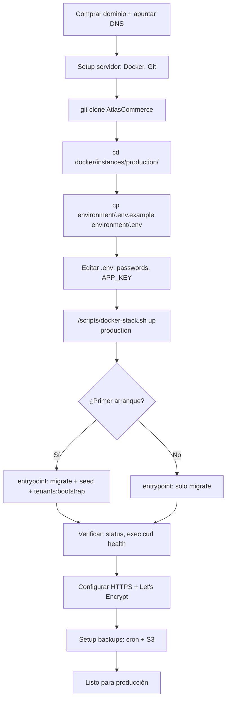

# Deploy Multi-Instance — Workflow por Instancia

> Guía paso a paso para deployar una instancia del sistema en un
> servidor nuevo. Asume que ya tenés el repo clonado y un servidor
> con Docker instalado.

---

## Vista general

Cada instancia se deploya independientemente:

| Instancia                                | Servidor               | Tiendas                       |
| ---------------------------------------- | ---------------------- | ----------------------------- |
| `panda-estampados-and-kitsune/` (prod)   | Server A (multi-tenant)| Panda + Kitsune               |
| `mm-boutique/` (prod)                    | Server B (single-tenant)| MM Boutique                  |
| `morales-store/` (prod)                  | Server C (single-tenant)| Morales Store                |

Cada servidor corre un único stack Docker con la instancia
correspondiente. La base de código es la misma; lo que cambia es
el `environment/.env`, el `Caddyfile` y los `seeds/*.json`.

> **Convencional entrypoint:** toda la operatoria va por
> [`scripts/docker-stack.sh`](../../scripts/docker-stack.sh "scripts/docker-stack.sh"),
> NO usar `docker compose` directo. Ver AGENTS.md raíz.

---

## Pre-requisitos del servidor

```bash
# Docker Engine + Compose plugin v2
sudo apt install docker.io docker-compose-plugin

# Git + utilidades
sudo apt install git curl jq vim

# Verificar versiones
docker --version          # >= 24.x
docker compose version    # >= 2.x (plugin)
git --version
```

Puertos expuestos al público (uno por servidor):

| Puerto | Servicio | Caddy                                       |
| ------ | -------- | ------------------------------------------- |
| 80     | HTTP     | sí (redirect a HTTPS en prod)               |
| 443    | HTTPS    | sí (certificados Let's Encrypt automáticos) |

Puertos internos (no expuestos al público) — nombres de servicio
**varían entre dev y prod**:

| Container port | Servicio             | Dev service name | Prod service name |
| -------------- | -------------------- | ---------------- | ----------------- |
| 8000           | Backend Laravel      | `backend`        | `app`             |
| 4321           | Frontend Astro       | `frontend`       | `frontend`        |
| 5432           | PostgreSQL           | `postgres`       | `db`              |
| 6379           | Redis                | `redis`          | `redis`           |

El dispatcher `scripts/docker-stack.sh` abstrae la diferencia:
siempre pasás `<stage> <store>` y un nombre de servicio canónico
(`backend`/`frontend`/`postgres`/`redis`); el script traduce a
`app`/`db` si el stage es `production`.

---

## Workflow de deploy — primera vez

### 1. Clonar el repo

```bash
sudo mkdir -p /opt/atlas-commerce
sudo chown $USER:$USER /opt/atlas-commerce
cd /opt/atlas-commerce
git clone https://github.com/D4nitrix13/AtlasCommerce.git
cd AtlasCommerce
```

### 2. Configurar la instancia

```bash
cd docker/instances/production/<store>   # ej: mm-boutique

# Copiar template de variables de entorno
cp environment/.env.example environment/.env

# Editar .env: cambiar TODOS los valores CAMBIAR_*
$EDITOR environment/.env
```

Valores críticos a cambiar en `environment/.env`:

```env
APP_KEY=                     # Generar con:
                             #   ./scripts/docker-stack.sh exec production <store> \
                             #       app php artisan key:generate --show
DB_PASSWORD=                 # Password seguro de Postgres
<STORE>_ADMIN_PASSWORD=      # Password del admin de la tienda.
                             # Variable según instancia:
                             #   PANDA_ADMIN_PASSWORD | MM_ADMIN_PASSWORD
                             #   MORALES_ADMIN_PASSWORD
```

> **Sobre `<STORE>_ADMIN_PASSWORD`:** el entrypoint de prod
> (`backend/entrypoint.production.sh`) lee esta variable al
> inicializar la BD para crear el admin user del seed. El sufijo
> `<STORE>` depende de la instancia:
> `PANDA_ADMIN_PASSWORD` para `panda-estampados-and-kitsune`,
> `MM_ADMIN_PASSWORD` para `mm-boutique`,
> `MORALES_ADMIN_PASSWORD` para `morales-store`.

Generar `APP_KEY`:

```bash
# Levantar solo el backend momentáneamente para generar la key.
# Antes hay que tener el .env configurado (DB_PASSWORD al menos).
./scripts/docker-stack.sh up production <store> backend
./scripts/docker-stack.sh exec production <store> backend \
    php artisan key:generate --show
# → base64:XYZ123... (copiar este valor a APP_KEY en .env)
```

### 3. Levantar los servicios

```bash
./scripts/docker-stack.sh up production <store>
```

El primer arranque tarda más (build de imágenes). El entrypoint:

1. Espera a que Postgres esté listo.
2. Genera `APP_KEY` si no existe.
3. Corre migraciones.
4. Corre seeders (currencies + permissions).
5. Corre `tenants:bootstrap` con el JSON de `seeds/`.
6. Arranca PHP-FPM.

Ver el progreso:

```bash
./scripts/docker-stack.sh logs production <store> backend -f
```

### 4. Verificar

```bash
# Estado de los servicios
./scripts/docker-stack.sh status production <store>

# Health check del backend (dentro del container backend)
./scripts/docker-stack.sh exec production <store> backend \
    curl -I http://localhost:8000/up
# HTTP/1.1 200 OK

# Health check del frontend (dentro del container frontend)
./scripts/docker-stack.sh exec production <store> frontend \
    curl -I http://localhost:4321/
# HTTP/1.1 302 Found (redirect a /es)

# Health check de Caddy (desde el host)
curl -I http://localhost/
# HTTP/1.1 200 OK
```

> **Nota sobre los puertos `8000` y `4321`:** estos son los puertos
> **internos de los containers** (donde Laravel y Astro escuchan
> dentro de la red de docker). Las instancias de prod **no
> publican estos puertos al host**; el tráfico HTTP entra por
> Caddy vía dominio (`panda-estampados.com`, etc.). Los `curl` de
> arriba se ejecutan **dentro del container** vía
> `scripts/docker-stack.sh exec`. Ver
> [`docs/operations/ports.md`](../operations/ports.md "operations/ports.md")
> para el mapa completo.

### 5. Configurar DNS

Para cada dominio de la instancia, apuntar al servidor:

```dns
# Ejemplo para mm-boutique.com
A   mm-boutique.com         <IP-SERVER>
A   www.mm-boutique.com     <IP-SERVER>
A   admin.mm-boutique.com   <IP-SERVER>
```

En el registrador de dominios (Cloudflare, Namecheap, etc.),
agregar estos registros A.

---

## Workflow de deploy — actualizaciones

```bash
ssh usuario@servidor
cd /opt/atlas-commerce/AtlasCommerce

# Traer últimos cambios
git pull

# Rebuild + restart (la instancia se apaga y se vuelve a levantar)
./scripts/docker-stack.sh up production <store>
```

Si hay migraciones nuevas:

```bash
./scripts/docker-stack.sh exec production <store> backend \
    php artisan migrate --force
```

Si hay cambios en `seeds/*.json`:

```bash
./scripts/docker-stack.sh exec production <store> backend \
    php artisan tenants:bootstrap seeds/<archivo>.json
```

---

## HTTPS con Let's Encrypt (producción)

En el `Caddyfile` de cada instancia, **quitar** la línea `auto_https off`
y dejar que Caddy gestione los certificados automáticamente:

```caddyfile
{
    email ops@example.com   # Email para Let's Encrypt
}

https:// {
    @hostnames host mm-boutique.com www.mm-boutique.com \
                       admin.mm-boutique.com

    handle @hostnames {
        @api path /api/*
        handle @api {
            reverse_proxy app:8000
        }
        handle {
            reverse_proxy frontend:4321
        }
    }

    handle {
        respond "Not found" 404
    }
}
```

> **Nombre de servicio:** en prod Caddy habla con `app` (no
> `backend`). El compose de prod define el servicio PHP-FPM como
> `app` — ver `docker/instances/production/<store>/docker-compose.yml`.

Caddy automáticamente:

- Obtiene certificados de Let's Encrypt vía HTTP-01 challenge.
- Los renueva antes de expirar.
- Redirige HTTP a HTTPS.

Para que Let's Encrypt emita certificados, **el puerto 80 debe
estar abierto al público** y el dominio debe apuntar al servidor.

DNS-01 challenge (alternativa para wildcards):

Si usás DNS-01, agregás el módulo de tu proveedor en el Caddyfile:

```caddyfile
{
    email ops@example.com
    acme_dns cloudflare {env.CLOUDFLARE_API_TOKEN}
}
```

---

## Backups

### Automático con cron

Cada servidor tiene su propio cron job que dumpa la BD. Forma
canónica: usar el subcomando `db-backup` del dispatcher (que ya
escribe a `db-backups/<stage>-<store>-<YYYY-MM-DD-HHMM>.sql.gz`):

```bash
# /etc/cron.d/atlas-commerce-backup
0 3 * * * root cd /opt/atlas-commerce/AtlasCommerce \
  && /opt/atlas-commerce/AtlasCommerce/scripts/docker-stack.sh \
       db-backup production <store> \
  >> /var/log/atlas-commerce-backup.log 2>&1
```

> **Sobre `db-backup`:** corre `pg_dump` dentro del container
> postgres del tenant y deja el archivo en `db-backups/` (relativo
> a la raíz del repo). Para subirlo a S3 / Drive, agregar `aws s3
> cp` o `rclone copy` al final del cron. Detalle completo en
> [`operations/backups.md`](../operations/backups.md "operations/backups.md").

### Restore

Forma canónica:

```bash
./scripts/docker-stack.sh db-restore production <store> \
    db-backups/<archivo>.sql.gz
```

Forma manual (equivalente, NO recomendado):

```bash
# Bajar el último backup
aws s3 cp s3://<bucket>-backups/<store>/<timestamp>.sql.gz /tmp/

# Restaurar vía pg_restore del container postgres del tenant
gunzip < /tmp/<file>.sql.gz | \
    /usr/bin/docker exec -i <store>-prod-db \
        psql -U postgres -d <store_slug>
```

Retención: 30 días mínimo. Configurar lifecycle en S3 para borrar
automáticamente los backups más viejos.

---

## Monitoreo

Mínimo viable:

- **Logs centralizados**: Loki + Grafana o servicio equivalente.
- **Uptime**: UptimeRobot, Betterstack, etc.
- **Métricas**: Prometheus + Grafana (opcional, para VPS grandes).

Para setup de monitoreo per-instance con Prometheus, ver
[`operations/observability-runbook.md`](../operations/observability-runbook.md "operations/observability-runbook.md").

---

## Troubleshooting

### El primer arranque falla con "connection refused" a Postgres

El entrypoint reintenta cada 2 segundos, pero si tarda más:

```bash
./scripts/docker-stack.sh logs production <store> postgres
# Verificar que el container de DB está healthy
./scripts/docker-stack.sh status production <store>
```

### El container `backend` reinicia constantemente (prod)

```bash
./scripts/docker-stack.sh logs production <store> backend --tail 100
```

Causas comunes:

- `APP_KEY` no seteada → el entrypoint la genera, pero si el
  `.env` está mal, falla.
- `DB_PASSWORD` no coincide con el del `docker-compose.yml`.
- `tenants:bootstrap` falla por JSON malformado. Verificar que el
  seed es JSON válido:

```bash
./scripts/docker-stack.sh exec production <store> backend \
    cat /tmp/seeds/<file>.json | jq .
```

### 502 Bad Gateway desde Caddy

El backend no está respondiendo:

```bash
./scripts/docker-stack.sh logs production <store> backend
./scripts/docker-stack.sh exec production <store> backend \
    curl -I http://localhost:8000/up
```

> El `curl` apunta al `:8000` interno del container. Se ejecuta
> desde dentro del container via `exec`.

Si Caddy arranca antes que el backend, va a fallar. El `depends_on`
con `condition: service_healthy` debería prevenir esto, pero si el
healthcheck del backend falla, hay que revisarlo.

### El admin user no puede loguearse

El password puede no haberse cargado bien:

```bash
./scripts/docker-stack.sh exec production <store> backend \
    php artisan tinker --execute='
$user = App\Models\Auth\User::where("email", "admin@example.com")->first();
echo $user ? "OK" : "NOT FOUND";
'
```

Si existe pero el password no funciona, verificar que la variable
`<STORE>_ADMIN_PASSWORD` (ej. `PANDA_ADMIN_PASSWORD`,
`MM_ADMIN_PASSWORD`, `MORALES_ADMIN_PASSWORD`) está bien seteada
en `environment/.env`.

### Migración falla

```bash
./scripts/docker-stack.sh exec production <store> backend \
    php artisan migrate --pretend
# Ver el SQL que se va a correr

./scripts/docker-stack.sh exec production <store> backend \
    php artisan migrate --force
# Forzar la corrida
```

Si está atascada en una migración:

```bash
./scripts/docker-stack.sh exec production <store> backend \
    php artisan migrate:rollback --step=1
# Rollback de la última migración
```

### Quiero agregar una tienda nueva a una instancia existente

Por ejemplo, agregar Morales Store a la instancia de MM Boutique
(que tiene 1 tienda). Editar `seeds/mm-boutique.json`:

```json
{
  "tenants": [
    { "slug": "mm-boutique", ... },
    { "slug": "morales-store", ... }
  ],
  ...
}
```

Correr:

```bash
./scripts/docker-stack.sh exec production <store> backend \
    php artisan tenants:bootstrap seeds/mm-boutique.json
```

El comando es idempotente: agrega Morales Store sin tocar MM
Boutique.

---

## Setup inicial del DNS — checklist

```txt
[ ] Comprar dominios (o usar subdominios de uno existente).
[ ] Configurar registros A apuntando a la IP del servidor.
[ ] Esperar propagación DNS (puede tardar hasta 48h).
[ ] Verificar con `dig mm-boutique.com` que apunta al servidor.
[ ] Habilitar HTTPS en Caddy (quitar auto_https off).
[ ] Verificar que Let's Encrypt emite el certificado.
[ ] Verificar que el sitio carga con HTTPS.
[ ] Configurar HSTS en Caddy para forzar HTTPS siempre.
```

## Resumen del workflow



## Documentación relacionada

- [`docker/instances/README.md`](../../docker/instances/README.md) — Índice
  de instancias.
- [`multi-instance-roadmap.md`](../architecture/multi-instance-roadmap.md) —
  Roadmap completo.
- [`linting.md`](../development/linting.md) — Linters del proyecto.
- [`installation.md`](../getting-started/installation.md) — Setup de dev local.
- [Caddy docs](https://caddyserver.com/docs/) — Configuración de Caddy.
- [Docker Compose docs](https://docs.docker.com/compose/) — Referencia de compose.
